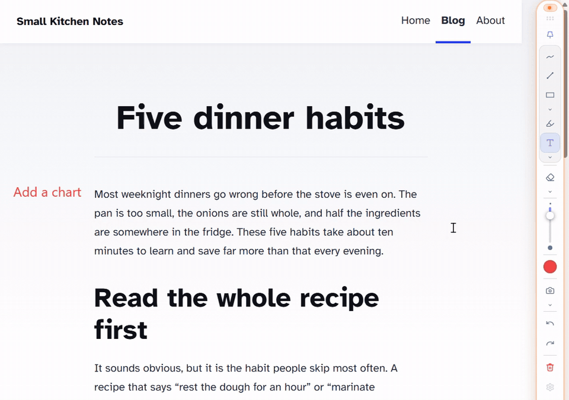

# @openpen/text

A text annotation tool for [OpenPen](https://github.com/openpen-platform/openpen).

Click anywhere on screen, type, and the text is placed where you clicked.
Committed text is placed as-is and cannot be re-edited; undo it and place it
again to change it.

<p align="center">
  
</p>

<p align="center"><sub>Background: Astro blog template (https://github.com/withastro/astro), MIT License (https://opensource.org/license/mit), with the article column narrowed to 600 px. The article is fictional.</sub></p>

## Install

Requires OpenPen 1.7.0 or later.

Install from the plugin catalog, then restart OpenPen:

```bash
npx openpen-cli plugin install @openpen/text
```

To install a build from source instead, build the plugin, then add the
directory to OpenPen and restart it:

```bash
npm install
npm run build
npx openpen-cli plugin add .
```

## Usage

1. Click the **Text** button in the control bar's tools group, or press
   **Ctrl+Alt+T** (**Command+Option+T** on macOS) while drawing mode is on, to
   switch to the text tool. To change how the next text looks, click the small arrow beside
   the button to open the style panel (see [Style panel](#style-panel)).
2. Click where the text should start. A text box opens at that point.
3. Type the text.
   - **Enter** or clicking away commits the text.
   - **Shift+Enter** starts a new line.
   - **Esc** cancels and discards what you typed.
4. While typing, hold **Ctrl** and scroll the mouse wheel to change the font
   size. Scrolling up enlarges the text and scrolling down shrinks it, within
   the 8 to 96 range. The new size is saved as the **Font size** setting.
5. Clicking elsewhere on the canvas commits the open text and opens a new box
   at the new position.

Empty or whitespace-only text is discarded. Text is drawn in the current stroke
color. While an input method editor (IME) is composing, Enter and Esc go to the
IME instead of committing or cancelling. Switching to another tool closes an
open text box without committing it.

Text is part of the drawing history, so it can be undone and redone like any
other stroke. The font size, font, bold and italic are fixed when the text is
placed; changing them later does not restyle text that is already on screen.

## Shortcuts

| Key | Action |
| --- | --- |
| **Ctrl+Alt+T** (**Command+Option+T** on macOS) | Switch to the text tool while drawing mode is on |
| **Ctrl + wheel** | Change the font size while typing |

The tool shortcut can be rebound under **Settings → Shortcuts**. A plain **T**
is never intercepted, so it types normally in every app.

## Style panel

Click the small arrow beside the **Text** button in the control bar. The panel
works the same in the horizontal and the vertical control bar, and changes
apply to the next text you place.

- **Font size**: drag the slider (8 to 96 pixels).
- **Font**: pick one of the listed fonts. Each name is shown in its own font.
- **Bold** and **Italic**: toggle each independently.

The choice is saved and restored the next time OpenPen starts.

## Settings

Open OpenPen's settings and choose the **Text** panel. It holds the same four
options as the style panel.

| Setting | Values | Default | Description |
| --- | --- | --- | --- |
| **Font size** | 8 to 96 | 24 | Size of the text in pixels; also changed by Ctrl+wheel while typing. Values outside the range are clamped. |
| **Font** | `sans`, `serif`, `mono`, `arial`, `verdana`, `times`, `courier`, `kai`, `handwriting` | `sans` | Font family; an unknown value falls back to `sans` |
| **Bold** | on, off | off | Draw the text in bold |
| **Italic** | on, off | off | Draw the text in italic |

The named fonts use the matching system font and fall back to a similar one
when it is not installed: `sans` is the system UI font, `serif` Georgia,
`mono` the system monospace font, `kai` a Kai (calligraphy) typeface and
`handwriting` a casual handwriting face. Availability of the others depends on
the operating system.

## License

MIT
